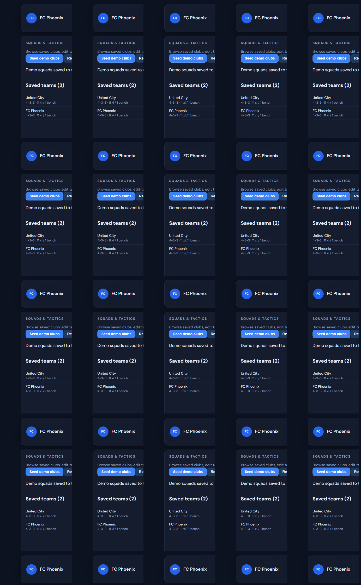
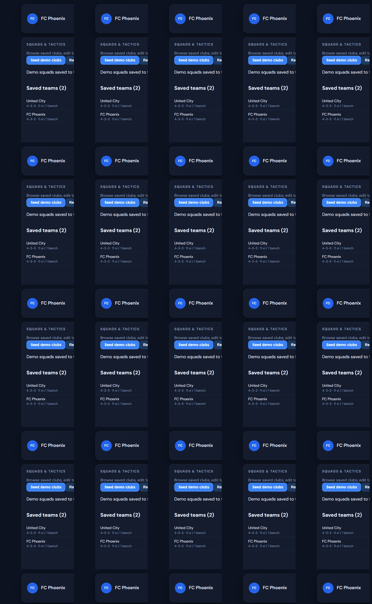
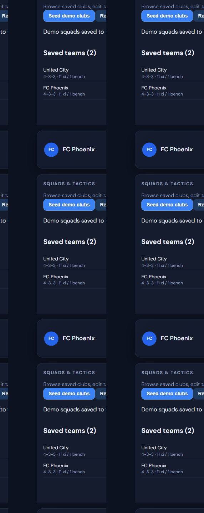

# Global Soccer Manager


**Open-source football match simulator and live match viewer** — deterministic
possession-chain engine, narrated events, REST + WebSocket API, and a React
touchline UI with squad hub, manager controls, and statistics.

Repository: [github.com/Keshav-Kmr/Global-Soccer-Manager](https://github.com/Keshav-Kmr/Global-Soccer-Manager)

## Screenshots

**Live match viewer** — squad hub, pitch coordinates, manager controls, team stats, and team-colored commentary feed:



| Controlled match flow | Team-colored match events |
|---|---|
|  |  |

---

## Overview

Global Soccer Manager pairs a **seeded match simulation engine** with a
**FastAPI delivery layer** and a **React match viewer**. Outcomes emerge from
player attributes, structural tactics, and controlled variance — not from a
separate animation layer. Every full match is **reproducible from its seed**,
which keeps tests honest and makes wild results easy to share.

The product goal is classic football-manager tension in text and data:
*"enters the box… shoots… GOAL!"* — with an optional top-down pitch driven by
real coordinates embedded in match events.

---

## Key features

### Match engine

| Area | What you get |
|------|----------------|
| **Simulation** | 11v11 possession chains, contest resolution, fatigue, home advantage, weather |
| **Tactics** | Mentality, tempo, pressing, width, defensive line, marking — change mid-match with measurable effect |
| **Set pieces & discipline** | Fouls, cards, injuries, substitutions (incl. AI auto-subs), simplified offside and penalties |
| **Narration** | Template commentary tied to event type and player attributes |
| **Determinism** | Same teams + tactics + seed → same event log; headless replay with optional manager `actions` |

### Backend API

| Area | What you get |
|------|----------------|
| **REST** | Create auto or **controlled** matches; advance (step, target minute, next key event, until full time); pause/resume |
| **Manager** | In-match tactic changes, formation updates, substitutions, live statistics |
| **WebSocket** | Live stream of commentary events with monotonic `index` for reliable client sync |
| **Persistence** | SQLite for teams and **finished** match results (statistics, summary, player end states) |
| **Snapshots** | `GET/POST /matches/{id}/snapshot`, `POST /matches/{id}/restore` for controlled session state |
| **Replay** | `POST /matches/replay` (headless); `POST /matches/{id}/replay` to verify against a stored result |
| **Validation** | Lineup checks on `POST /matches` (formation slots, duplicate IDs, cross-team overlap) |

Interactive docs: `http://127.0.0.1:8000/docs` (or your chosen port).

### Frontend match viewer

| Area | What you get |
|------|----------------|
| **Live match** | Scoreboard with clock and stoppage, team-colored event feed, SVG pitch from engine coordinates |
| **Statistics** | Team and player panels (goals, shots, possession, passes proxy, cards, and more) |
| **Manager controls** | Advance match, pause, full tactic + formation controls, substitutions |
| **Squad hub** | Browse seeded teams, edit tactics, save squads via API, load home/away lineups |
| **Replay UX** | Highlight and replay the last key moment on the pitch |

Stack: React 18, TypeScript, Vite — lives in `frontend/app/`.

### Tooling & quality

- **pytest** — engine, delivery, persistence, replay (100+ tests)
- **Vitest** — frontend unit tests
- **CI** — `.github/workflows/ci.yml` runs backend tests and frontend build on push/PR
- **Scripts** — CLI menu, batch calibration, live WebSocket client, database seeding

---

## How results are built

Three forces stay in balance so none of them swallows the others:

| Pillar | Role |
|--------|------|
| **Player quality** | Attributes drive every duel on the pitch. |
| **Tactics** | Shape *which* phases happen and *who* they favor — not just a flat odds multiplier. |
| **Variance** | Probabilities stay away from 0/100; weaker sides still have a real chance. |

---

## Architecture

```
 React viewer (frontend/app)
        │  REST + WebSocket (commentary events, pitch snapshots)
        ▼
 delivery/api          →  FastAPI routes (matches, teams)
        │
        ▼
 delivery/services     →  MatchService, TeamService, Pacer (live pacing)
        │
        ├── persistence/   SQLite — teams + finished results
        │
        ▼
 engine + commentary   →  Deterministic simulation + narrative text
        │
        ▼
 domain                →  Player, Team, Formation, Tactic
```

The engine is synchronous and seed-driven. **`Pacer`** is the only layer that
introduces real-time delay for live viewing — the same engine can run one
streamed match or thousands of headless simulations with identical outputs.

---

## Repository layout

```
backend/
  app/
    domain/        Player, Team, Formation, Tactic
    engine/        Match simulation (possession chains, probability, events)
    commentary/    Event → narrative strings
    delivery/      FastAPI api/, services/, schemas
    persistence/   SQLite repositories
    generation/    Fictional teams (license-clean, no real-world data)
  scripts/         menu.py, simulate_demo.py, batch_simulate.py, live_client.py, seed_database.py
  tests/           Engine, delivery, persistence, replay

frontend/app/      React + TypeScript + Vite match viewer
docs/              Engine notes, batch calibration JSON
```

---

## Getting started

**Prerequisites:** Python **3.12+**, Node **16+** (18+ recommended).

### 1. Backend

**Windows (PowerShell):**

```powershell
cd backend
python -m venv .venv
.\.venv\Scripts\Activate.ps1
pip install -e ".[dev]"
.\.venv\Scripts\pytest.exe -q
.\.venv\Scripts\uvicorn.exe app.main:app --host 127.0.0.1 --port 8000 --reload
```

**macOS / Linux:**

```bash
cd backend
python3 -m venv .venv && source .venv/bin/activate
pip install -e ".[dev]"
pytest -q
uvicorn app.main:app --host 127.0.0.1 --port 8000 --reload
```

If port **8000** is blocked on Windows (`WinError 10013`), use **8010** (see frontend step below).

Optional:

```powershell
.\.venv\Scripts\python.exe scripts\simulate_demo.py          # one match to stdout
.\.venv\Scripts\python.exe scripts\batch_simulate.py -n 100 -o ..\docs\batch_calibration_results.json
.\.venv\Scripts\python.exe scripts\seed_database.py            # fictional teams in SQLite
```

### 2. Frontend

With the API running:

```powershell
cd frontend\app
npm install
npm run dev
```

Open **http://127.0.0.1:5173** → configure squads in **Squad hub**, then **New controlled match** and advance with manager controls.

**Alternate API port (e.g. 8010):** create `frontend/app/.env`:

```env
VITE_API_BASE=http://127.0.0.1:8010
VITE_WS_BASE=ws://127.0.0.1:8010
```

Restart `npm run dev`. The Vite dev proxy also targets **8010** when you use the default `/api` base.

### Useful commands

| Command | Purpose |
|---------|---------|
| `python scripts/menu.py` | Interactive scenarios with commentary |
| `python scripts/live_client.py` | CLI WebSocket client for auto matches |
| `npm run build` / `npm test` | Production build and frontend tests |

### Replay API (example)

Headless full match with a mid-game tactic change:

```http
POST /matches/replay
Content-Type: application/json

{
  "team_a": { "...": "..." },
  "team_b": { "...": "..." },
  "seed": 4242,
  "actions": [
    {
      "at_minute": 30,
      "action": "tactic_change",
      "team_id": "club_home",
      "tactic": { "mentality": "attacking" }
    }
  ]
}
```

Returns score, events (with commentary), statistics, summary, and player states.

---

## Documentation

| Doc | Description |
|-----|-------------|
| [`docs/MATCH_ENGINE_NOTES.md`](docs/MATCH_ENGINE_NOTES.md) | Plain-language engine walkthrough |
| [`docs/batch_calibration_results.json`](docs/batch_calibration_results.json) | Sample batch metrics (goals, shots, possession) |
| [`CLAUDE.md`](CLAUDE.md) | Project vision and conventions |
| [`backend/app/engine/CLAUDE.md`](backend/app/engine/CLAUDE.md) | Engine design (deep dive) |
| [`backend/app/delivery/CLAUDE.md`](backend/app/delivery/CLAUDE.md) | API and streaming |
| [`frontend/app/README.md`](frontend/app/README.md) | Viewer setup details |

---

## Contributing

Issues and pull requests are welcome. Read the area-specific `CLAUDE.md` files
before changing engine, delivery, or frontend code. Keep changes **deterministic**
(seeded), **tested**, and scoped — the engine contract is the foundation for
everything above it.

---

## License

[Apache License 2.0](LICENSE)